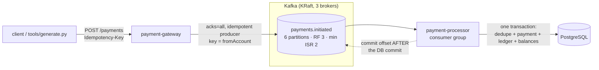

# PayFlow Sim

[](https://github.com/KulmeetSJ/payflow-sim/actions/workflows/ci.yml)

An event-driven payments simulator built to practise what payment platforms need from SRE and platform teams:
- durable acceptance
- idempotent processing
- per-account ordering
- retries and dead-lettering
- tracing, SLOs and burn-rate alerts
- load and chaos testing

> **All data is synthetic.** Accounts, amounts and formats are generated; nothing resembles a real bank's schemes or fields.
> Every number in this repo is a personal-project benchmark on a laptop.

## Architecture (Phase 1)



| Guarantee | How |
|---|---|
| `202 Accepted` means durably stored | The gateway waits for the broker ack; `acks=all` with `min.insync.replicas=2` means 2 of 3 replicas have it |
| Client retries don't double-pay | `eventId` is derived from the `Idempotency-Key`; the processor's `processed_events` primary key turns repeats into no-ops |
| Redelivery after a crash doesn't double-pay | The offset is committed only after the DB transaction. A crash in between causes redelivery, which the same dedupe absorbs. At-least-once delivery, exactly-once effect |
| Payments from one account are applied in order | Message key = `fromAccount`, so the account always maps to the same partition, and one consumer owns a partition at a time |
| No deadlocks between opposite transfers | Both account rows are locked in a fixed order (`ORDER BY account_id FOR UPDATE`) |
| Ledger always balances | A DEBIT and a CREDIT are written in the same transaction as the balance updates; `balance >= 0` is a DB constraint |
| Business-rule failures are visible, not lost | Currency mismatch, unknown account, over the limit, insufficient funds → payment row `REJECTED` with a reason, and no ledger entries |

## Run it
Requires Docker (about 3.5 GB of memory for the stack) and JDK 21 for the tests.
```bash
echo "POSTGRES_PASSWORD=$(openssl rand -hex 16)" > .env   # gitignored; generated per machine
docker compose up -d --build        # 3 Kafka brokers, PostgreSQL, gateway (:8080), processor (:8081)

curl -s -X POST localhost:8080/payments \
  -H 'Content-Type: application/json' -H 'Idempotency-Key: demo-0000001' \
  -d '{"fromAccount":"ACC-000003","toAccount":"ACC-000006","amount":25.00,"currency":"GBP"}'
# {"paymentId":"…","status":"ACCEPTED"}

curl -s localhost:8081/payments/<paymentId>     # status, reject_reason, e2e_ms
tools/generate.py --count 500 --rate 50         # synthetic load, ~2% deliberately invalid
docker compose down -v
```
Accounts `ACC-000001`…`ACC-001000` are seeded with 100,000.00 each. The currency is GBP when n % 3 = 0, EUR when n % 3 = 1, and USD when n % 3 = 2.

## Tests
`./mvnw verify` runs unit tests and integration tests against **real Kafka and PostgreSQL** (Testcontainers):
- **Gateway:** an accepted payment lands on the topic keyed by account; a retry with the same key returns the same id; a missing or bad key and an invalid body get 400.
- **Processor:** a valid payment gets a balanced ledger and moves both balances; a currency mismatch is `REJECTED` with no ledger entries; the same event delivered 3× is booked once.
- **Rules:** a table of 10 business-rule cases.

## Roadmap
- [x] **Phase 1:** core flow, 3-broker KRaft cluster, idempotent producer and consumer, Testcontainers, CI
- [ ] **Phase 2:** retry topics + DLT with replay, consumer-group scaling demo (1→3→6→7), cooperative-sticky assignor
- [ ] **Phase 3:** OpenTelemetry traces across Kafka, RED + lag dashboards, SLOs with multi-window burn-rate alerts
- [ ] **Phase 4:** k6 load test, chaos (broker kill, consumer kill, DB latency), blameless postmortem

## License
MIT
