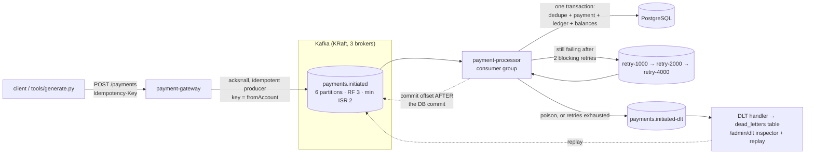

# PayFlow Sim

[](https://github.com/KulmeetSJ/payflow-sim/actions/workflows/ci.yml)

An event-driven payments simulator built to practise what payment platforms need from SRE and platform teams:
- durable acceptance
- idempotent processing
- per-account ordering
- retries and dead-lettering
- tracing, SLOs and burn-rate alerts
- load and chaos testing

> **All data is synthetic.** Accounts, amounts and formats are generated; nothing resembles a real bank's schemes or fields.
> Every number in this repo is a personal-project benchmark on a laptop.

## Architecture



| Guarantee | How |
|---|---|
| `202 Accepted` means durably stored | The gateway waits for the broker ack; `acks=all` with `min.insync.replicas=2` means 2 of 3 replicas have it |
| Client retries don't double-pay | `eventId` is derived from the `Idempotency-Key`; the processor's `processed_events` primary key turns repeats into no-ops |
| Redelivery after a crash doesn't double-pay | The offset is committed only after the DB transaction. A crash in between causes redelivery, which the same dedupe absorbs. At-least-once delivery, exactly-once effect |
| Payments from one account are applied in order | Message key = `fromAccount`, so the account always maps to the same partition, and one consumer owns a partition at a time |
| No deadlocks between opposite transfers | Both account rows are locked in a fixed order (`ORDER BY account_id FOR UPDATE`) |
| Ledger always balances | A DEBIT and a CREDIT are written in the same transaction as the balance updates; `balance >= 0` is a DB constraint |
| A failing payment doesn't block its partition | Transient errors: 2 quick in-place retries, then retry topics (1 s / 2 s / 4 s), then the DLT. Poison messages go to the DLT on the first attempt |
| Business-rule failures are visible, not lost | Currency mismatch, unknown account, over the limit, insufficient funds → payment row `REJECTED` with a reason, and no ledger entries |

## Run it
Requires Docker (about 3.5 GB of memory for the stack) and JDK 21 for the tests.
```bash
echo "POSTGRES_PASSWORD=$(openssl rand -hex 16)" > .env   # gitignored; generated per machine
docker compose up -d --build        # 3 Kafka brokers, PostgreSQL, gateway (:8080), processor (:8081)

curl -s -X POST localhost:8080/payments \
  -H 'Content-Type: application/json' -H 'Idempotency-Key: demo-0000001' \
  -d '{"fromAccount":"ACC-000003","toAccount":"ACC-000006","amount":25.00,"currency":"GBP"}'
# {"paymentId":"…","status":"ACCEPTED"}

curl -s localhost:8081/payments/<paymentId>     # status, reject_reason, e2e_ms
tools/generate.py --count 500 --rate 50         # synthetic load, ~2% deliberately invalid
docker compose down -v
```
Accounts `ACC-000001`…`ACC-001000` are seeded with 100,000.00 each. The currency is GBP when n % 3 = 0, EUR when n % 3 = 1, and USD when n % 3 = 2.

## Partitioning and ordering
The gateway keys every event by `fromAccount`. Kafka hashes the key to a partition, and within a consumer group a partition has exactly one owner, so all payments from one account are applied one at a time, in the order they were accepted. This matters because the balance check depends on order: "deposit then spend" and "spend then deposit" can give different answers.

With round-robin (no key), two payments from the same account could land on different partitions and be processed in parallel by different instances. The second could then overtake the first. The row locks would stop the balance from going negative, but the *outcome* (which payment is rejected for insufficient funds) would depend on timing. `PaymentFlowIT.paymentsFromOneAccountAreAppliedInSendOrder` sends 20 payments from one account and checks they share a partition and were committed in send order.

## Retries and the DLT
Business-rule failures (currency mismatch, insufficient funds, …) are not errors: they are recorded as `REJECTED`. Exceptions mean something else went wrong, and they are handled in two layers ([`RetryConfig`](payment-processor/src/main/java/dev/demo/payflow/processor/RetryConfig.java)):

| Failure | Handling | Why |
|---|---|---|
| Transient (DB blip, pool timeout) | **2 blocking retries**, 200 ms apart, in place | A short blip is absorbed without the payment leaving its partition, so per-account order is kept |
| Still failing | **Non-blocking** `@RetryableTopic`: `retry-1000` → `retry-2000` → `retry-4000` → DLT | The partition keeps flowing. **Trade-off:** that one payment may now be applied after later payments from the same account |
| Poison (unparseable JSON, unknown schema, `eventId` not derived from the Idempotency-Key) | Straight to the DLT, 1 attempt | Retrying can't fix it; retrying would only delay everything behind it |

Every dead letter is indexed in a `dead_letters` table (original topic/partition/offset, exception class and message, stack trace, attempts). The DLT topic stays the source of truth. With `ADMIN_ENDPOINTS_ENABLED=true` (on in compose, off by default, no auth because this is a local simulator):

```bash
curl -s localhost:8081/admin/dlt?pending=true              # list
curl -s -X POST localhost:8081/admin/dlt/42/replay         # 202, or 422 if it is still unparseable
curl -s -X POST 'localhost:8081/admin/faults?keyPrefix=demo-&failures=3'   # inject transient faults
```
Replay is always safe: if the payment was in fact booked, the `processed_events` dedupe turns the replay into a no-op.

[`demos/retry-dlt.sh`](demos/retry-dlt.sh) runs each path against the compose stack ([output](demos/output/)):

| Case | Result |
|---|---|
| Fault ×2 | absorbed by the blocking retries; booked on attempt 1 |
| Fault ×3 | booked from the first retry topic (`delivery_attempt=2`), about 2 s end to end |
| Fault never clears | DLT after 4 attempts (12 tries in total, counting blocking retries); not booked; replayed once fixed → booked; a second replay → still exactly 2 ledger rows |
| Not JSON | DLT on attempt 1; replay refused with 422; the next payment on the same partition goes straight through |

**Something I didn't expect:** each blocking retry costs about 500 ms, not 200 ms. After the error handler seeks back, the consumer still has a long-poll fetch in flight for that partition, and it waits up to `fetch.max.wait.ms` (default 500 ms) before refetching. Lowering that setting would speed retries up but make idle consumers poll the brokers harder.

## Consumer scaling
`payments.initiated` has 6 partitions. [`demos/consumer-scaling.sh`](demos/consumer-scaling.sh) scales the processor 1 → 3 → 6 → 7 → 3 while ~40 payments/s keep flowing, and records the assignment after each step. Excerpt from [a run](demos/output/):

```
## 6 instance(s)                          ## 7 instance(s)
    payment-processor-1  partitions: 0        payment-processor-1  partitions: 0
    payment-processor-2  partitions: 3        ...  (unchanged)  ...
    ...                                       payment-processor-6  partitions: 5
    payment-processor-6  partitions: 5        payment-processor-7  partitions: (idle: no partitions)

accepted by gateway (202): 6000   reached a final state: 6000 (lost: 0)
ledger net 0.00 · balances per currency unchanged · redeliveries skipped by dedupe: 1
```
- **The 7th instance sits idle.** Parallelism is capped by the partition count, so partitions are sized for the maximum number of consumers you expect.
- **Cooperative-sticky assignor.** With the default eager protocol, every rebalance revokes *all* partitions from *all* members first, so the whole group stops. Cooperative rebalancing only revokes the partitions that move. In the run above, adding the 7th instance moved nothing, and going from 1 to 3 instances let instance 1 keep partitions 0 and 1 throughout.
- **One redelivery, absorbed.** In the run shown, one event was redelivered around a rebalance (processed, but its offset not yet committed when the partition moved). Dedupe skipped it. An earlier run had none.
- Kafka 4 also offers the new consumer group protocol (KIP-848, `group.protocol=consumer`), where the broker computes assignments incrementally. I stayed on the classic protocol + cooperative-sticky because it is what most production clusters still run.

## Tests
`./mvnw verify` runs unit tests and integration tests against **real Kafka and PostgreSQL** (Testcontainers):
- **Gateway:** an accepted payment lands on the topic keyed by account; a retry with the same key returns the same id; a missing or bad key and an invalid body get 400.
- **Processor:** a valid payment gets a balanced ledger and moves both balances; a currency mismatch is `REJECTED` with no ledger entries; the same event delivered 3× is booked once; 20 payments from one account are committed in send order.
- **Retries and DLT:** a fault that outlasts the blocking retries is booked from a retry topic exactly once; a permanent fault ends in the DLT after 4 attempts, then replay books it and a second replay changes nothing; malformed JSON and a tampered `eventId` reach the DLT on attempt 1 without blocking the partition.
- **Rules:** a table of 10 business-rule cases.

## Roadmap
- [x] **Phase 1:** core flow, 3-broker KRaft cluster, idempotent producer and consumer, Testcontainers, CI
- [x] **Phase 2:** blocking + non-blocking retries, DLT with inspector and replay, consumer-group scaling demo (1→3→6→7→3), cooperative-sticky assignor
- [ ] **Phase 3:** OpenTelemetry traces across Kafka, RED + lag dashboards, SLOs with multi-window burn-rate alerts
- [ ] **Phase 4:** k6 load test, chaos (broker kill, consumer kill, DB latency), blameless postmortem

## License
MIT
